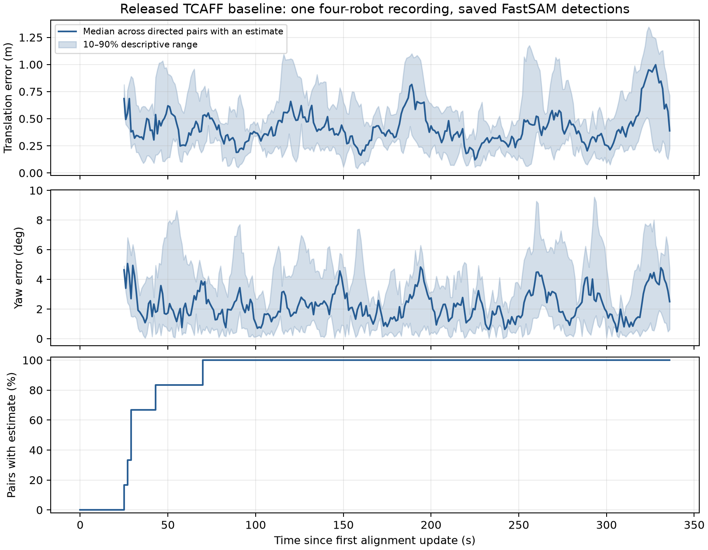

# Бейслайн: совмещение систем координат роботов в TCAFF

Этот документ описывает исследуемый метод, данные и метрики, на которых он оценивается, и то, насколько точно его удалось воспроизвести. Все дальнейшие эксперименты сравниваются с полученным здесь бейслайном B0. Основные числа прослеживаются до сохранённых файлов через [таблицу доказательств](../results/evidence.csv).

## Задача и метод

TCAFF (Peterson, Lusk, Avila, How, ICRA 2025; [arXiv 2405.05210](https://arxiv.org/abs/2405.05210)) совмещает системы координат соседних роботов без начального приближения. Каждый робот знает свою позу только в собственной системе одометрии, которая к тому же дрейфует, а для совместной работы, например для общего сопровождения пешеходов, ему нужно преобразование $T^{i}_{j}\in SE(2)$ из системы одометрии соседа $j$ в свою систему $i$. TCAFF ищет его, сопоставляя разреженные карты объектов, которые роботы строят из сегментов FastSAM — сегментатора без фиксированного списка классов — и которыми обмениваются раз в секунду.

Объект получается из одной маски FastSAM и выровненной глубины. Центр — центроид маски, поднятый в 3D на медианной валидной глубине $\tilde d$ её пикселей; ширина и высота — стороны ограничивающего прямоугольника маски в пикселях, пересчитанные в метры на той же глубине: $w=\tilde d\,\Delta u/f_x$, $h=\tilde d\,\Delta v/f_y$. Поэтому размеры описывают видимый сегмент, а не физический предмет. Трекер карты ведёт пятимерное состояние $(x,y,z,w,h)$ и сопоставляет наблюдения венгерским алгоритмом с порогом 12 на удвоенный отрицательный логарифм правдоподобия ассоциации, $-2\log L$. Объект карты $o$ описывается центром $p_o$, размерами $w_o,h_o$ и возрастом $\ell_o$ — числом шагов картирования (по 0.1 с) с последнего наблюдения; объект удаляется, когда $\ell_o$ превышает $\kappa=200$ шагов, то есть 20 с. При совмещении используются только координаты XY центра.

Совмещение двух карт $\mathcal M_i,\mathcal M_j$ состоит из четырёх стадий. Сначала размерный допуск отбирает кандидаты в соответствия:

$$g_\alpha(a,b)=\prod_{f\in\lbrace w,h\rbrace}\mathbb 1\left[\frac{\max(f_a,f_b)}{\min(f_a,f_b)}\le 1+0.35\alpha\right]\mathbb 1\big[\,|f_a-f_b|\le 0.1\alpha\,\big],\qquad \mathcal A=\lbrace(a,b)\in\mathcal M_i\times\mathcal M_j:\ g_\alpha(a,b)=1\rbrace.$$

В бейслайне $\alpha=1$: отношение размеров не больше 1.35 и разность не больше 0.1 м по обеим сторонам. Затем CLIPPER строит граф согласованности кандидатов. Для двух кандидатов $u=(a,b)$ и $v=(a',b')$ сравниваются расстояния между центрами в двух картах:

$$d(u,v)=\Big|\,\lVert p_a-p_{a'}\rVert-\lVert p_b-p_{b'}\rVert\,\Big|,\qquad M_{uv}=\exp\left(-\frac{d(u,v)^2}{2\sigma^2}\right)\mathbb 1\big[d(u,v)<\varepsilon\big],\quad \sigma=0.15\ \text{м},\ \varepsilon=0.25\ \text{м}.$$

Два кандидата с общим объектом CLIPPER считает несогласованными, $M_{uv}=0$, поэтому клика задаёт взаимно-однозначное соответствие. CLIPPER ищет клику $C$ взаимно согласованных кандидатов с наибольшей плотностью: бинарный индикатор клики релаксируется в неотрицательный вектор $\mathbf y$, и качество решения оценивается величиной $F(C)=\mathbf y^\top M\mathbf y/\mathbf y^\top\mathbf y$, где $\mathbf y$ обнулён вне клики. TCAFF решает эту задачу несколько раз — MNO, несколько почти оптимальных решений: после каждого решения обнуляет блок матрицы, соответствующий найденной клике, и повторяет поиск, всего $N=4$ раза. Сохраняются решения, у которых $F$ больше 0.75 от лучшего, не меньше пяти соответствий и нет отражения. Каждая сохранённая клика даёт измерение преобразования взвешенным методом Аруна:

$$z_C=\arg\min_{T\in SE(2)}\sum_{(a,b)\in C}w_{ab}\,\lVert p_a-T\,p_b\rVert^2,\qquad w_{ab}=\frac{1}{0.01+\ell_a\ell_b},$$

так что недавно виденные объекты весят больше.

Последняя стадия — временной фильтр, заимствующий идею многогипотезного сопровождения (MHT). Каждая ветвь дерева — фильтр Калмана для $x=(x,y,\psi)$ с постоянным шумом измерения $R=\mathrm{diag}(0.5^2,\,0.5^2,\,(5^\circ)^2)$, следящий за одной модой совмещения — одним из альтернативных преобразований, которые порождают разные клики. Стоимость ветви — сумма отрицательных логарифмов правдоподобия выбранных измерений; шаг без измерения стоит $-\log p_{NM}$ с $p_{NM}=0.001$. Из каждого измерения запускается разведочное дерево с окном $W=8$ шагов; основное дерево, а с ним и оценка $\hat x_k$, появляется, когда накопленная стоимость лучшей разведочной ветви становится меньше порога $\tau$. До этого момента оценки нет. В опубликованной версии кода $\tau=9$, в статье 8.

При чтении кода найдены два расхождения со статьёй, которые сохранены без изменений. Функция `Node.mahalanobis_diff` возвращает уже квадратичную форму $q=r^\top S^{-1}r$, а `Node.nlml` возводит её в квадрат ещё раз, $\tfrac12\big(q^2+\log\det S+3\log 2\pi\big)$, тогда как гауссовский член в статье содержит $q$. Кроме того, в статье шаг без измерения стоит $-\log p_{NM}-\tfrac32\log 2\pi$, а в коде только $-\log p_{NM}$. Оба расхождения касаются временного фильтра, а не исследуемых стадий сопоставления, поэтому их исправление не входит ни в одну из проверок.

## Данные и оценка

Доступна одна авторская запись TCAFF MOT dataset: четыре робота RR01, RR04, RR06 и RR08 ездят по комнате 10×10 м с системой захвата движения, где ходят шесть пешеходов и стоят 26 неподвижных препятствий (по описанию датасета — коробки, их координаты XY даны в `objects.txt`). Роботы снимают RGB-D камерой RealSense L515, одометрия — Kimera-VIO по камере D455. Совмещение обновляется раз в секунду для каждой из 12 направленных пар, всего $337\times12=4044$ обновления; они зависимы, и 12 направлений не являются 12 независимыми экспериментами.

Истинное относительное преобразование строится по захвату движения и одометрии:

$$T^{GT}=T^{\mathrm{odom}_i}_{r_i}\,\big(T^{w}_{r_i}\big)^{-1}\,T^{w}_{r_j}\,\big(T^{\mathrm{odom}_j}_{r_j}\big)^{-1},$$

где $T^{w}_{r_i}$ — поза робота $i$ в системе захвата движения, а $T^{\mathrm{odom}_i}_{r_i}$ — его поза в собственной одометрии. Ошибка оценки вычисляется из $(T^{GT})^{-1}\hat T$ в $SE(2)$: перенос $t$ в метрах и модуль угла $|\psi|$ в градусах. Авторская метрика — ошибки, усреднённые сначала внутри направленной пары, затем по парам; отдельно считается доступность, доля обновлений с оценкой.

Дальше используются четыре определения. Порог точности — 1 м и 5°: обновление верное, если оценка есть и отличается от истины не больше чем на 1 м и 5°. Основная метрика проверок 4–8 — доля верных обновлений $\mathrm{Acc}$ среди всех 4044; обновления без оценки считаются неверными, поэтому $\mathrm{Acc}$ учитывает и точность, и доступность. Неверная мода — принятая оценка дальше 2 м или 15° от истины, то есть выбор другой моды совмещения, а не неточная оценка верной. Неверное первое решение — первая принятая оценка за порогом точности; это может быть и неверная мода, и оценка у самого порога. CLIPPER использует `std::random_device`, поэтому каждый вариант прогоняется пять раз, а разница вариантов считается заметной, если она превышает разброс решателя — размах метрики по повторам. Это не статистический тест: у метрик, которые решатель почти не меняет (у B0 размах доступности равен нулю), критерий отмечает любой детерминированный сдвиг на этой записи.

## Что воспроизведено и как проверено

Воспроизведена цепочка «сохранённые авторские детекции FastSAM → исходное картирование → размерный допуск → MNO-CLIPPER → временной фильтр». TCAFF закреплён на коммите `ff4ceab`, CLIPPER — на `e514dc2`. Демонстрационный скрипт авторов скопирован в [src/demo_cpu](../src/demo_cpu) с изменениями только для запуска без нейросетей и сохранения входов фильтра; картирование и вычисление истины совпадают с авторскими ([подробности](4_reproduction.md#происхождение-кода)). Нейросетевой фронтенд в бейслайне не запускался, а сопровождение пешеходов и метрика MOTA не воспроизводились.

Корректность прогона проверена двумя независимыми способами. Временной фильтр повторно проигрывается на сохранённых измерениях MNO и должен дать те же оценки: несовпадений 0 из 4044, наибольшее отклонение $8.9\cdot10^{-16}$. Истинное преобразование собирается независимо от кода авторов по той же формуле: наибольшее отклонение $5.3\cdot10^{-15}$. Прогоны проверок 4–8 проходят обе сверки. В проверке 2 фильтр проигрывается заново на каждом шаге, а истина берётся из сохранённых и уже проверенных данных B0; от ранней проверки 1 сохранены только сводки.

## Результаты бейслайна

| Метрика | Значение |
|---|---:|
| Перенос / угол, среднее средних по парам (прогон с опубликованными параметрами) | 0.4379 м / 2.446° |
| Доступность | 3598/4044 = 88.97% |
| Доля верных обновлений $\mathrm{Acc}$, среднее 5 повторов | 76.69% (размах 0.47 п.п.) |
| Первое принятие оценки, медиана по парам | 29 с (от 25 до 70 с) |
| Время шага совмещения (`TCAFFManager.update`) на 29-шаговое окно | 0.83 с |

Ошибки близки к опубликованным 0.43 м и 2.3° (раздел IV-C статьи), но не повторяют их точно: в статье $\tau=8$, а сопровождение пешеходов здесь не запускалось. Контроль с $\tau=8$, выполненный только для временного фильтра на тех же измерениях, дал те же ошибки и доступность.

Неудачи B0 по 20 220 обновлениям пяти повторов раскладываются на три слагаемых:

$$1-\mathrm{Acc}=U_{pre}+E_\psi+E_t=0.110+0.083+0.040=0.233,$$

где $U_{pre}$ — обновления до первого принятия оценки, $E_\psi$ — принятые оценки с $t\le1$ м и $|\psi|>5^\circ$, $E_t$ — принятые оценки с $t>1$ м. Разложение точное, потому что после первого принятия оценка у B0 не пропадает ни разу; у вариантов с ослабленным допуском такие пропадания есть, но занимают не больше 0.13% обновлений. Все принятые оценки B0 за порогом точности лежат у самого порога: ошибки не больше 1.40 м и 10.0°; в $E_\psi$ медиана угла 6.1° и 90-й процентиль 7.8°, в $E_t$ межквартильный размах переноса 1.07–1.22 м. Из 60 первых принятий на всей записи (12 направлений × 5 повторов) за порог точности выходят 10, все в паре RR01↔RR04 и тоже у самого порога. Таким образом, **потери B0 — поздний первый старт и неточная оценка верного совмещения**; неверных мод он на этой записи не принимает. Хуже всего пара RR06↔RR08: 61.8% и 66.8% верных обновлений в двух направлениях при 20.8% обновлений без оценки; лучше всего RR04↔RR06, 88.4% и 88.5%. Почему старт поздний и откуда берётся неточность, разбирается в [документе о диагностике](2_diagnostics.md).
