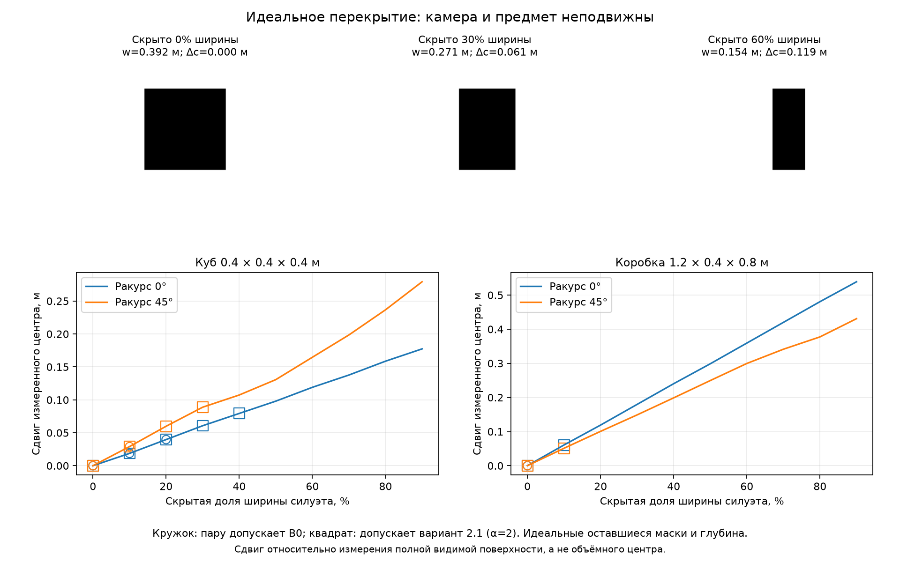

# Диагностика: что ограничивает бейслайн

[Бейслайн](1_baseline.md) теряет 23.3% обновлений: 11.0% до первого принятия оценки и 12.3% на принятых оценках у порога точности; неверных мод он не принимает. Обе потери зависят от верной поддержки — числа соответствий, согласных с истинным преобразованием, которые доходят до CLIPPER, — и от их точности. Поэтому диагностика проверяла по очереди стадии, определяющие эту поддержку: начиная с ручной проверки идентичности соответствий, затем размерный допуск, единицу сегмента FastSAM и состав соответствий, на которых держится совмещение. В конце документа наблюдения сведены в постановку проблемы, которую проверяют гипотезы [следующего документа](3_hypotheses.md).

## Ручная проверка идентичности соответствий

Близость центров в двух картах не доказывает, что это один предмет, а сохранённые детекции не содержат ни масок, ни классов. Поэтому идентичность проверялась вручную по изображениям. Якорем называется шаг записи, на котором при истинном преобразовании не меньше пяти пар объектов лежат ближе 0.6 м друг к другу до размерного допуска и меньше пяти после него, то есть допуск лишает CLIPPER минимальной клики. Выбраны 24 якоря, по четыре на каждую из шести пар роботов, не ближе 40 обновлений друг к другу. В пул вошли все 798 близких пар объектов на этих якорях — и отброшенные допуском, и допущенные, и близкие альтернативы. Разметчик видел изображения последних и первых наблюдений треков и синхронизированные кадры якоря; размеры, решение допуска и результат совмещения были скрыты. Отбор шёл по 3D-расстоянию, тогда как алгоритм работает на плоскости: после допуска B0 совместимая пятёрка в XYZ отсутствовала на всех 24 якорях, а в XY сохранялась на шести.

Ответы распределились так: 314 «один объект», 341 «разные объекты», 67 «часть и целое или неоднозначно», 76 «невозможно установить»; уверенность высокая в 616 ответах, средняя в 101, низкая в 81. Единица подсчёта — ответ на пару наблюдений карты в одном якоре, а не уникальный предмет: один предмет может иметь несколько треков, а один трек входит в несколько пар. Разметку выполнил один человек без физических идентификаторов, поэтому согласованность разметчиков не измерена. Пул обогащён трудными случаями — близкими парами в эпизодах потери поддержки — и не является случайной выборкой всех кандидатов.

Чтобы понять, на каких предметах лежат эти пары, каждое из 1596 наблюдений поставлено в мировую систему по истинной позе и отнесено к классу только по положению: пол ($z<0.08$ м), препятствие (ближе 0.35 м по XY к точке из `objects.txt` и $z<0.9$ м), край комнаты ($|x|$ или $|y|>4.5$ м), высоко ($z>1.2$ м) и прочее. У препятствий лежат 63% наблюдений, у края комнаты — 17%, в классе «прочее» — 13%, на полу — 7%, высоко — два наблюдения. Среди пар «один объект» 68% лежат у препятствий и 29% у края комнаты. Часть класса «прочее» — роботы: все 54 задания с пометкой разметчика о роботе получили ответ «невозможно установить», и в 50 из них одна сторона по истине лежит ближе 0.3 м к другому роботу или пешеходу. Ещё в 57 заданиях без пометки одна сторона лежит так же близко к движущемуся объекту.

## Размерный допуск почти не различает идентичность

| Ответ разметчика | Всего | B0 исключает | B0 допускает | Вариант 2.1 ($\alpha=2$) допускает |
|---|---:|---:|---:|---:|
| Один объект | 314 | 260 | 54 | 124 |
| Разные объекты | 341 | 304 | 37 | 101 |

Допуск B0 отбрасывает 83% пар «один объект» и 89% пар «разные объекты»; среди пар «один объект» с высокой уверенностью он отбрасывает 178 из 220. На этом пуле он почти не различает идентичность:

$$\mathrm{LR}_+=\frac{P(g_1=1\mid \text{один})}{P(g_1=1\mid \text{разные})}=\frac{54/314}{37/341}=1.58,\qquad \alpha=2:\ \frac{124/314}{101/341}=1.33.$$

Это оценка на обогащённом пуле без доверительного интервала, и она ничего не говорит о второй роли допуска — сокращении числа кандидатов «все со всеми», без которого задача CLIPPER растёт: карты на 24 якорях разметки содержат от 12 до 118 объектов, и сопоставление «все со всеми» даёт на них до 9579 кандидатов, медиана около 5600.

Причина слабого различения — изменчивость наблюдаемых размеров. В 632 историях треков с не меньше чем пятью наблюдениями размах размеров между 10-м и 90-м процентилями выходит за допуск в 420 случаях, а первое и последнее измерения расходятся сильнее допуска в 384. Дело и не в усреднении размеров трекером: если заменить размер карты последним сырым измерением, из 178 отброшенных пар «один объект» высокой уверенности исключёнными остаются 173.

Один из возможных механизмов — частичная видимость. Идеальная модель неподвижных камеры и кубоида с экраном, закрывающим часть силуэта, даёт 80 случаев для двух форм, двух ракурсов, двух направлений экрана и десяти долей закрытия. Для куба 0.4 м при фронтальном ракурсе закрытие 30% ширины силуэта уменьшает наблюдаемую ширину до 0.271 м и сдвигает центр на 0.061 м: B0 такую пару отбрасывает, вариант 2.1 ($\alpha=2$) допускает. При закрытии 60% ширина 0.154 м, сдвиг 0.119 м, и пару отбрасывают оба варианта. Модель показывает, что механизм возможен, но не его частоту в реальной записи.

## Что FastSAM считает объектом

Сохранённые детекции не содержат масок, поэтому FastSAM-x был заново прогнан на 800 кадрах, по 200 на робота, с параметрами обёртки TCAFF. Среди новых масок нашлись 89% сохранённых детекций с медианным расхождением центра 6 мм и ширины 5 мм; новых масок в 2.5 раза больше, и края кадра касаются 36% лишних масок против 0.5% совпавших, то есть авторы, по-видимому, отбрасывали маски у края. Каждая маска проецировалась в 3D и сопоставлялась с координатами 26 препятствий; у препятствий лежат 39% масок, которые получал TCAFF (2127 из 5397).

| Сегменты у препятствий | Доля, 95% интервал бутстрепа по кадрам |
|---|---:|
| Одна коробка | 65% (63–67%) |
| Несколько коробок (медиана 2, до 5) | 32% (30–34%) |
| Коробка вместе с фоном | 3% (2–3%) |

Единица сегмента неустойчива и во времени: у 31% видимых коробок в одном кадре есть два и более сегмента, единица сегмента коробки меняется между соседними кадрами выборки (около 1.7 с) в 23% случаев, а вложенные маски есть в 89% кадров. Интервалы считаются по кадрам как по независимым единицам, хотя соседние кадры коррелированы. Глубина внутри маски почти не проверяется: у 43% масок валидная глубина есть меньше чем у половины пикселей, у 18% не меньше 10% пикселей лежат дальше 0.3 м от медианы, причём такая многослойность встречается у 5% масок одной коробки и у 33% слитых сегментов.

Это объясняет и разброс центров. Если прогнать трекер карты на сохранённых детекциях с истинными позами и сравнить наблюдения одного трека, разнесённые не меньше чем на 2 с, расхождение центров по XY имеет медиану 0.23 м и 90-й процентиль 0.89 м (83 511 пар); для треков на препятствиях — 0.20 и 0.63 м. У 47% треков препятствий больше пятой части наблюдений приходится на соседнюю коробку: для пар на одной ближайшей коробке 90-й процентиль 0.16 м, на разных — 0.66 м. Изменчивость центров, таким образом, в основном связана с тем, что считается объектом, а не с шумом измерения одного предмета.

## Из чего состоят соответствия CLIPPER

Объекты карт B0 переведены в мировую систему и отнесены к тем же классам, а шаг совмещения повторён на сохранённых картах каждого десятого шага; берётся решение CLIPPER, ближайшее к оценке, принятой в прогоне. Повтор CLIPPER стохастичен и приближает клики прогона, но не воспроизводит их точно.

| Класс | Объекты карты | Соответствия CLIPPER, оба конца одного класса |
|---|---:|---:|
| Край комнаты | 41.5% | 22.6% |
| Прочее (в том числе роботы) | 26.6% | 4.8% |
| Препятствия | 23.3% | 54.0% |
| Пол | 7.9% | 0.5% |
| Высоко | 0.6% | 0% |
| Разнотипные пары | — | 18.1% |

Препятствия — меньшинство объектов карты, но на них приходится больше половины соответствий. Только 66% соответствий (1416 из 2144) связывают объекты, лежащие в мире ближе 0.5 м друг к другу. Остальные 728 — это 278 пар «препятствие — другое препятствие», 264 разнотипные пары, 109 пар у края комнаты, 71 пара в классе «прочее» и 6 на полу; 49 из этих 728 соответствий лежат ближе 0.3 м к роботу или пешеходу.

## Постановка проблемы

Обозначим через $S^{\ast}_k\subseteq\mathcal A_k$ кандидатов шага $k$, концы которых при истинном преобразовании оказываются ближе 0.5 м, а через $\pi=|C\cap S^{\ast}_k|/|C|$ — чистоту клики. У B0 общая доля таких соответствий во всех кликах $\bar\pi=1416/2144=0.66$. Это прокси, смещённый в обе стороны: соответствие соседней коробке на расстоянии 0.28 м он считает верным, а пару наблюдений одного предмета, центры которых разошлись больше чем на 0.5 м, — неверной, хотя такие расхождения часты (90-й процентиль для треков на препятствиях 0.63 м). Свидетельства идентичности входят в выбор клики только через бинарный допуск с $\mathrm{LR}_+=1.58$, а единица сегмента и центр объекта меняются от кадра к кадру.

Диагностика покрытия на сохранённых кандидатах B0 уточняет, откуда берётся задержка. До первого принятия хотя бы одно измерение MNO есть только на 39.8% шагов с истиной, а измерение в пределах порога точности — на 18.7%. Из 2230 шагов до первого принятия в 60 стартах (12 направлений × 5 повторов, которые у B0 стартуют одинаково, так что независимых стартов 12) 1290, или 58%, проходят до первого верного измерения; его медианный шаг 20. После него принятие в 40 стартах наступает через $W=8$ шагов — минимум, который задаёт окно фильтра, — в десяти через 15, а в паре RR06↔RR08 через 47; причину долгой задержки в этой паре мы не разбирали. Значит, больше половины $U_{pre}$ — ожидание первого верного измерения, а остальное приходится на окно фильтра и задержку в отдельных парах.

Надёжность выбора естественно описать запасом верной клики над лучшей кликой другой моды совмещения:

$$\Delta_k=F(C^{\ast}_k)-\max_{C:\ z_C\notin\mathcal N(T^{GT})}F(C),$$

где $C^{\ast}_k$ — лучшая клика с $z_C$ в окрестности истины $\mathcal N(T^{GT})$ радиусом в порог точности. $F$ определяет, какие клики доходят до фильтра, а окончательный выбор делает стоимость ветвей фильтра, поэтому полный запас включает и её. В этой работе запас не измерялся; о нём судят по тому, как вмешательства меняют принятые моды.

Из этого следуют три вопроса. Можно ли увеличить верную поддержку и раньше получить верное измерение, не дав такой же поддержки неверным модам? На него отвечают проверки 2, 4, 5, 6 и 8. Порождает ли примесь неверных соответствий ошибки принятых оценок у порога точности? На него отвечает проверка 7. И насколько мал запас $\Delta_k$ и что его разрушает? Об этом свидетельствуют все проверки вместе.
