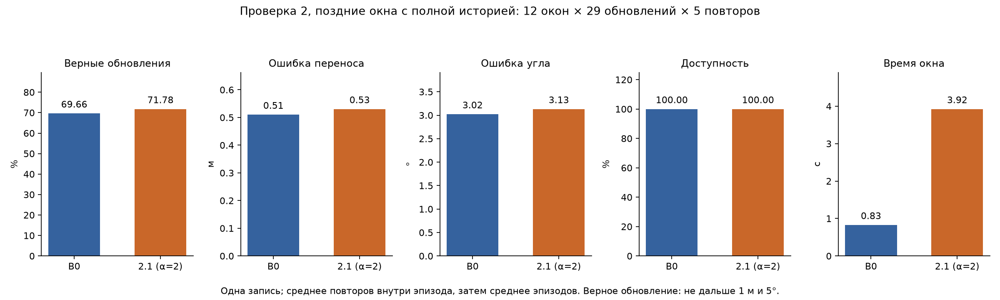
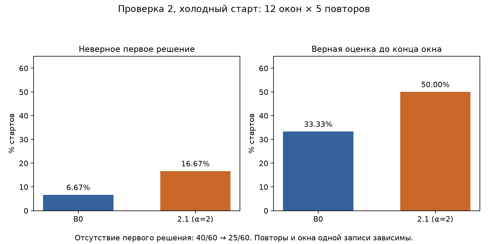
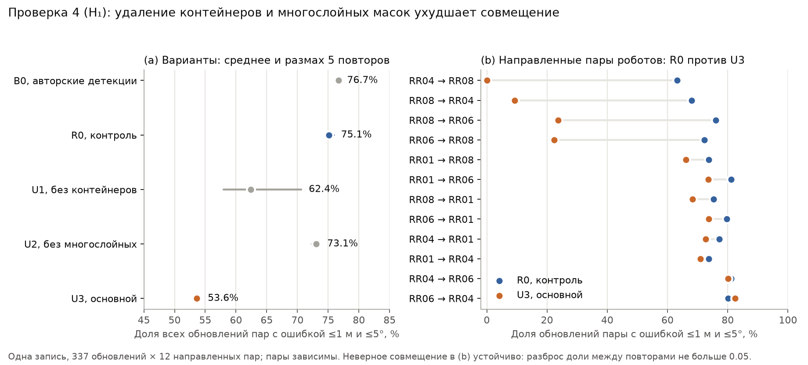

# Проверенные гипотезы и развитие идей TCAFF

Все попытки улучшить [бейслайн](1_baseline.md) собраны здесь в порядке выполнения. Ни одна не подтвердилась по своему правилу решения; первые семь не дали и устойчивого улучшения, а последняя, проверка 8, дала устойчивый прирост доли верных обновлений ценой большего числа неверных первых решений у порога точности. Каждая проверка сузила объяснение того, что ограничивает совмещение; ограничения, на которые они опираются, разобраны в [диагностике](2_diagnostics.md). Каждая проверка описана в одном формате: ограничение бейслайна, гипотеза, изменение метрик, вывод. Обозначения едины для всех документов: B0 — бейслайн; проверка N и гипотеза N (N = 1…8) — эксперимент и проверяемое в нём утверждение; вариант N.k — k-й вариант проверки N, а N.0 — её контроль, если он отличается от B0. Протоколы проверок записаны в [configs](../configs) до запуска вариантов. После проверок документ переходит к тому, как развивали идеи TCAFF сами авторы, и к итогу.

| № | Гипотеза | Главная метрика: база → вариант | Итог | Результаты |
|---|---|---|---|---|
| 1 | **Правила принятия и бюджет MNO.** Более строгое первое принятие — ниже порог стоимости или требование отрыва лучшей ветви фильтра от второй — уменьшит число неверных первых решений, а бюджет MNO 16 вместо 4 чаще даст фильтру верную моду | неверные первые решения 3/12 → 3/12 (1.3, отрыв по стоимости) или 1/12 при трёх направлениях без решения (1.1, строгий порог) | не подтверждена | [history](../results/history) |
| 2 | **Размерный допуск $\alpha=2$.** Ослабленный допуск вернёт пары одного объекта, которые отбрасывает B0, и совмещение улучшится | верные обновления в поздних окнах 69.7% → 71.8% (2.1) при размахе B0 2.3 п.п.; неверные первые решения 4 → 10 из 60; время ×4.7 | не подтверждена | [size_gate](../results/size_gate) |
| 3 | **Граница неопределённости центра и размера.** Если оценить для каждого наблюдения шум центра и границу его систематического смещения, отброшенные пары можно возвращать по сумме границ, не пропуская соседние объекты | 90% расхождения центров 0.63 м при $\varepsilon=0.25$ м | нереализуема | [uncertainty](../results/uncertainty) |
| 4 | **Единица сегмента.** Удаление масок-контейнеров и многослойных масок до картирования повысит точность совмещения без заметной потери доступности | Acc 75.1% → 53.6% (4.0 → 4.3) | не подтверждена | [unit_test](../results/segment_unit/unit_test) |
| 5 | **Динамические объекты (разведочный оракул).** Удаление детекций ближе $r$ к роботам и пешеходам уменьшит число неверных соответствий и улучшит совмещение | Acc 76.7% → 75.9% (5.1), 69.9% (5.2) | не подтверждена | [oracle_dynamic](../results/exploratory/oracle_dynamic) |
| 6 | **Мягкий вес размера.** Ослабленный допуск вместе со сходством размера в весах рёбер CLIPPER даст верную поддержку раньше, не дав преимущества неверным модам | Acc 76.7% → 77.4% (6.1); неверные первые решения 5 → 11 из 60 | не подтверждена | [support](../results/support) |
| 7 | **Устойчивая переоценка.** Переоценка каждой клики с потерей Geman–McClure вместо одношагового метода Аруна снизит долю принятых оценок за порогом точности | Acc 76.7% → 76.7% (7.1) | не подтверждена | [support](../results/support) |
| 8 | **Кластеры препятствий как кандидаты.** Если добавить в кандидаты CLIPPER пары кластеров близко стоящих предметов на полу с весом уверенности в кластере, вернётся поддержка, которую отбрасывает размерный допуск | Acc 76.7% → 79.0% (8.2); неверные первые решения 10 → 22 из 60, все у порога точности | не подтверждена по правилу, прирост Acc устойчив | [groups](../results/groups) |

## Проверка 1. Правила принятия и бюджет MNO

**Ограничение.** В ранней версии исследования B0 на сохранённых измерениях всех 12 направлений принимал первую оценку во всех 12, и в трёх из них она была неверной. Эти проверки выполнены с другими протоколами (сокращённые начальные отрезки записи, фиксированный seed), поэтому их числа нельзя сравнивать с B0 последующих проверок.

**Гипотеза.** Более строгое первое принятие уменьшит число неверных первых решений. Проверены три правила: более низкий порог стоимости (вариант 1.1, $\tau=-4.967$) и требование, чтобы лучшая ветвь отрывалась от второй по стоимости, $J_1<\tau$ и $J_2-J_1>\delta$, где $J_1\le J_2$ — две наименьшие стоимости среди всех ветвей (1.2, $\delta=12$) или среди групп ветвей, совпадающих в пределах порога точности (1.3, $\delta=1$). Вторая часть гипотезы: больший бюджет MNO, $N=16$ вместо 4 (1.4), чаще даст фильтру верную моду совмещения.

**Изменение метрик.** Вариант 1.1 принял оценку в 9 направлениях из 12, неверную — в одном; 1.2 не принял ни одной; 1.3 повторил B0: 12 принятых, 3 неверных. Вариант 1.4 на шести парах роботов изменил соотношение верных решений, неверных и отказов с 4/1/1 на 2/3/1.

**Вывод.** Отрыв по стоимости не отделяет верную моду от неверной: при малом $\delta$ он ничего не меняет, при большом блокирует все решения, а строгий порог убирает неверные старты вместе с верными. Больший бюджет MNO тоже не помог: два дополнительных неверных первых решения при $N=16$ лежат у самого порога точности (0.52 м и 5.1°, 1.12 м и 4.7°), а при пороге 2 м и 10° оба бюджета дают пять верных решений из шести. Неверных мод больший бюджет не добавил, но и не убрал.

## Проверка 2. Глобальное ослабление размерного допуска

**Ограничение.** Допуск B0 отбрасывает 260 из 314 пар, которые разметчик признал одним объектом.

**Гипотеза.** Если ослабить допуск $g_\alpha$, вернутся полезные соответствия, и совмещение улучшится. Оценка ведётся на окнах по 29 обновлений вокруг 24 якорей разметки: 12 ранних окон (до шага 150) служат для выбора $\alpha$ из $\lbrace 1.25, 1.5, 2\rbrace$ по правилу «не увеличить число неверных первых решений, затем максимизировать инициализацию и верные обновления», 12 поздних (с шага 170) — для оценки, по 5 повторов. Поздние окна ранее просматривались при диагностике. В поздних окнах фильтр продолжает прогон с начала записи; при холодном старте фильтр сбрасывается в начале окна (картирование не сбрасывается), что даёт 60 стартов. Выбран вариант 2.1, $\alpha=2$: отношение 1.7, разность 0.2 м.

**Изменение метрик.** Допуск возвращает 70 пар «один объект» и 64 пары «разные объекты». В поздних окнах (1740 обновлений) доля верных обновлений выросла с 69.66% до 71.78% (+2.13 п.п.). Это меньше размаха B0 по повторам (68.1–70.4%, 2.30 п.п.), хотя повторы двух вариантов не перекрываются: у 2.1 они лежат в пределах 71.6–72.1%. Перенос ухудшился с 0.510 до 0.531 м, угол — с 3.02° до 3.13°, а время шага совмещения на окно выросло с 0.83 до 3.92 с, в 4.73 раза. На всей записи тот же допуск, вариант 6.0 проверки 6, даёт 75.95% верных обновлений против 76.69% у B0. На холодных стартах неверных первых решений стало 10 из 60 вместо 4, стартов без решения 25 вместо 40, верная оценка до конца окна появилась в 30 стартах вместо 20. Повторы одного окна решают почти одинаково, поэтому неверные первые решения сосредоточены в немногих окнах: у B0 — в четырёх повторах из пяти одного окна пары RR01↔RR06, у 2.1 — во всех повторах этого окна и окна пары RR01↔RR04. Если менять сам порог точности (перенос от 0.25 до 2 м, угол от 2 до 10°, 12 комбинаций), ослабленный допуск даёт больше верных обновлений только в двух комбинациях, меньше — в девяти, а неверных первых решений у него больше во всех двенадцати.

**Вывод.** Критерия подтверждения в протоколе не было, поэтому вердикт «не подтверждена» — наше суждение по трём наблюдениям: прирост в поздних окнах меньше разброса B0, на всей записи $\alpha=2$ хуже B0, а неверных первых решений на холодных стартах больше. Ослабление сдвигает компромисс между задержкой и неверными стартами, но не улучшает его: вместе с верными парами допуск пропускает почти столько же неверных. Размер в виде жёсткого порога — слабый признак идентичности.

## Проверка 3. Совместная неопределённость размера и центра

**Ограничение.** Частичная видимость меняет и размеры, и центр наблюдения, а допуск не знает, насколько можно доверять конкретному наблюдению.

**Гипотеза.** Для каждого наблюдения оценивать ковариацию случайного шума центра $\Sigma$ и отдельную границу систематического смещения $B$ и возвращать отброшенную пару, если $\sqrt{\operatorname{tr}\Sigma_a}+\sqrt{\operatorname{tr}\Sigma_b}+B_a+B_b$ не превышает допустимого расхождения. До реализации проверялись новизна и возможность откалибровать границу на доступных данных.

**Изменение метрик.** Поиск литературы показал, что форма правила повторяет границы шума соответствий TEASER, а совместная модель положения и протяжённости объекта при ассоциации уже есть в Probabilistic Scene Graphs (2026); новой осталась только откалиброванная граница смещения по признакам маски ([метод поиска](4_reproduction.md#скрипты-проверок)). Калибровка не удалась: 90-й процентиль расхождения центров одного трека на препятствиях равен 0.63 м, больше $\varepsilon=0.25$ м и расстояния между соседними коробками 0.28 м. Признаки, доступные до совмещения, его не сужают: по терцилям дальности 0.71, 0.61 и 0.55 м, по терцилям размера маски 0.73, 0.57 и 0.59 м, ранговая корреляция с расхождением около −0.05. Граница, откалиброванная на трёх роботах, на четвёртом даёт покрытие 0.85–0.94 при целевом 0.90.

**Вывод.** Граница такой ширины пропускала бы соседние объекты, а изменчивость центров в основном связана с единицей сегмента, что и показал аудит FastSAM.

## Проверка 4. Стабилизация единицы сегмента

**Ограничение.** 32% сегментов препятствий захватывают несколько коробок, единица сегмента меняется в 23% соседних кадров, многослойная глубина встречается у трети слитых сегментов.

**Гипотеза.** Если до картирования убрать маски-контейнеры (вариант 4.1: внутри маски лежит не меньше 80% площади другой маски) и многослойные маски (4.2: не меньше 10% валидных пикселей лежат больше чем на 0.3 м за медианной глубиной или не меньше 10% — больше чем на 0.3 м перед ней), неизменённый TCAFF совместит карты точнее без заметной потери доступности. Основной вариант 4.3 убирает маски по обоим правилам. Контроль 4.0 — тот же новый прогон FastSAM-x на всех 13 546 кадрах без этих правил, но с отсевом масок у края кадра, который, судя по аудиту, применяли авторы; [протокол](../configs/unit_hypothesis.json).

**Изменение метрик.**

| Вариант, 5 повторов | Acc | Перенос / угол | Доступность | Неверные моды | Сегменты из нескольких коробок |
|---|---:|---:|---:|---:|---:|
| B0, авторские детекции (справочно) | 76.7% | 0.437 м / 2.45° | 89.0% | 0% | нет масок |
| 4.0, контроль | 75.1% | 0.502 м / 2.82° | 88.9% | 1.9% | 34.1% |
| 4.3, основной | 53.6% | 1.205 м / 12.73° | 80.7% | 14.1% | 26.1% |

Общая доля верных обновлений скрывает, где произошли потери. Если считать её отдельно для каждой из 12 направленных пар — как долю из 337 обновлений пары, в которых оценка не дальше 1 м и 5° от истины, — то в восьми парах вариант 4.3 отличается от контроля 4.0 не больше чем на 8 п.п. В четырёх парах — RR04→RR08, RR08→RR04, RR06→RR08 и RR08→RR06 — доля падает с 63–76% до 0%, 9%, 22% и 24%. В этих направлениях фильтр принимает оценки, повёрнутые в среднем на 30–38°, то есть неверную моду, и делает это одинаково во всех пяти повторах: доля верных обновлений меняется между повторами не больше чем на 0.05.

Неверную моду принимает уже контроль. У 4.0 неверные моды занимают 1.9% обновлений, все в паре RR04↔RR08: по 49 обновлений направления RR04→RR08 в каждом повторе и от 23 до 34 в обратном, а первые решения в этих двух направлениях во всех повторах повёрнуты на 14.9°. С авторскими детекциями B0 неверных мод не принимает, так что их появление связано с отличиями нового прогона FastSAM, а правила варианта 4.3 увеличивают их долю примерно в 7.5 раза и распространяют на пару RR06↔RR08.

Причину показывает разбор соответствий. На каждом десятом шаге первого повтора совмещение повторено на сохранённых картах, и соответствия CLIPPER разделены на связывающие одно место мира (ближе 0.5 м) и остальные. В этих четырёх направлениях у варианта 4.3 соответствий первого типа 133 против 487 у контроля, второго — 276 против 369. Правила убрали в первую очередь верную поддержку, и неверной стало больше, чем верной.

По отдельности правила ведут себя иначе. Вариант 4.1 даёт 62.4% верных обновлений, но повторы расходятся от 58% до 71%: в одних повторах пары с RR08 уходят в неверную моду, в других нет. Вариант 4.2 точнее контроля — 0.454 м и 2.45° против 0.502 м и 2.82°, — и неверных мод у него нет вовсе, но оценка у него есть реже (в 86.0% обновлений против 88.9%), поэтому верных обновлений 73.1%.

Панель (b) показывает, где именно потеряны верные обновления. Каждая строка — направленная пара «робот → сосед», то есть совмещение карты соседа с картой робота; по горизонтали — доля из 337 обновлений этой пары, в которых оценка есть и отличается от истины не больше чем на 1 м и 5°, среднее пяти повторов. Синяя точка — контроль 4.0, оранжевая — вариант 4.3, серая линия между ними — изменение. Пары упорядочены по изменению, сверху самое большое падение; четыре верхние строки — направления пар RR08 с RR04 и RR06, о которых сказано выше.

**Вывод.** Правила снизили долю слитых сегментов с 34.1% до 26.1%, но убрали в первую очередь соответствия, на которых держалось верное совмещение, и неверная мода, которую контроль принимал в одной паре на 1.9% обновлений, заняла 14.1% обновлений, почти все в двух парах. Пары с RR08 оказались самыми хрупкими.

## Проверка 5. Удаление динамических объектов (разведочный оракул)

**Ограничение.** 49 из 728 соответствий, связывающих разные места мира, лежат у роботов или пешеходов, а 54 задания разметчик пометил как связанные с роботом.

**Гипотеза.** Если убрать детекции ближе $r$ к другим роботам и пешеходам, неверных соответствий станет меньше, и совмещение улучшится. Удаление выполнялось по точным позициям из захвата движения с фиксированным радиусом, то есть это оракул, а не алгоритм; заранее проверка не регистрировалась.

**Изменение метрик.** В варианте 5.1 ($r=0.3$ м) удалено 9.6% детекций; Acc 75.90% против 76.69% у B0 — в пределах разброса повторов (1.51 п.п.), ошибки 0.468 м / 2.71° против 0.437 м / 2.45°; разброс почти целиком даёт один повтор из пяти, в котором направление RR06→RR08 приняло неверную моду на 49 обновлениях. В варианте 5.2 ($r=0.6$ м) удалено 13.1% детекций, Acc упала до 69.93%, ошибки выросли до 0.780 м / 14.50°, и 4.9% обновлений стали неверными модами — все в паре RR06↔RR08, где неверная мода занимает около трети обновлений.

**Вывод.** Удаление динамики не улучшает совмещение. При большем радиусе удаляется 13.1% детекций — вероятно, вместе с частью неподвижных объектов рядом с маршрутами, хотя это не измерялось, — и в той же хрупкой паре неверная мода становится устойчивой во всех повторах. Динамические объекты — не главное ограничение.

## Проверка 6. Мягкий вес размера

**Ограничение.** Размер входит в выбор только через бинарный допуск с $\mathrm{LR}_+=1.58$, а больше половины шагов до первого принятия проходит в ожидании первого верного измерения: до первого принятия верное измерение есть лишь на 18.7% шагов.

**Гипотеза.** Если ослабить допуск до $\alpha=2$ и внести сходство размера в веса рёбер CLIPPER средним геометрическим, как в ROMAN, верная поддержка появится раньше, а неверные моды преимущества не получат:

$$s(a,b)=\sqrt{\min\left(\frac{w_a}{w_b},\frac{w_b}{w_a}\right)\min\left(\frac{h_a}{h_b},\frac{h_b}{h_a}\right)},\qquad M'_{uv}=\big(M_{uv}\,s(u)\,s(v)\big)^{1/3}.$$

Вариант 6.1 — эта гипотеза, контроль 6.0 — только $\alpha=2$, как в варианте 2.1, но на всей записи; [протокол](../configs/support_hypotheses.json) общий с проверкой 7 и записан до прогонов. Механизм проверен до прогонов, но ещё до фиксации протокола, так что эта часть проверки не предрегистрирована: на размеченных парах $s$ отделяет «один объект» от «разных» с площадью под ROC-кривой (AUC) 0.658, 95% интервал бутстрепа по эпизодам [0.585; 0.728], на отброшенных допуском парах 0.661.

**Изменение метрик.**

| 5 повторов | B0 | 6.0 | 6.1 |
|---|---:|---:|---:|
| Acc, вся запись | 76.69% | 75.95% | 77.44% |
| Нет оценки до первого принятия | 11.03% | 10.51% | 9.16% |
| Принято, $t>1$ м | 3.96% | 7.60% | 7.20% |
| Неверные моды (дальше 2 м или 15°) | 0% | 2.66% | 2.53% |
| Перенос / угол | 0.437 м / 2.45° | 0.677 м / 6.80° | 0.666 м / 6.61° |
| Неверные первые решения, вся запись | 10 из 60 | 30 из 60 | 20 из 60 |
| Неверные первые решения, холодный старт | 5 из 60 | 10 из 60 | 11 из 60 |

На всей записи вариант 6.1 превосходит B0 на 0.76 п.п. при размахе 0.47 п.п. и 6.0 на 1.49 п.п. при размахе 0.40 п.п.; время шага совмещения у 6.1 в 4.4 раза больше, чем у варианта 7.1 с исходным допуском (у прогонов B0 время не записывалось). Выигрыш сосредоточен в нескольких парах: RR04→RR08 74.2% → 82.3%, RR08→RR04 80.6% → 82.8%, RR04→RR01 72.4% → 76.7%, тогда как RR01→RR08 теряет 5.3 п.п., а RR08→RR01 — 3.3 п.п. Неверные моды на всей записи — это серия примерно из 50 шагов в паре RR06↔RR08, около 15% её обновлений в обоих направлениях и во всех повторах; у 6.0 та же серия занимает 16%.

На холодных стартах B0 прогнан заново для сравнения с 6.0 и 6.1 и из-за стохастичности CLIPPER дал 5 неверных первых решений вместо 4 в проверке 2; все они у самого порога точности в одном окне пары RR01↔RR06 (медианная ошибка в окне 0.53 м и 2.6°). У 6.1 в том же окне 5 стартов принимают неверную моду (медианная ошибка угла в окне около 88°), ещё 5 — в окне пары RR01↔RR08 (около 23°), и один старт у порога. У 6.0 неверная мода есть в первом из этих окон, но не во втором. Повторы одного окна решают почти одинаково, поэтому по существу сравниваются окна: неверные первые решения B0 лежат в одном окне из 12, у 6.1 — в трёх. Ошибка самого первого решения не сохранялась, и то, что старт принял неверную моду, выведено из медианной ошибки окна.

Результат содержит смешение: кубический корень меняет само геометрическое ядро — при $s\equiv1$ он превращает $M$ в ядро с $\sigma\sqrt3\approx0.26$ м, — а контроля с $s\equiv1$ в протоколе не было, поэтому разница 6.1 и 6.0 не приписывается одному размеру.

**Вывод.** По правилу протокола гипотеза не подтверждена: неверных первых решений на холодном старте вдвое больше, чем у B0, и десять из одиннадцати, судя по медианной ошибке окна, — неверные моды, которых у B0 нет. Ослабление допуска до $\alpha=2$ с весом и без него вместе с верной поддержкой ускоряет и поддержку неверных мод; вес меняет конкуренцию мод в отдельных парах, но неверную моду в RR06↔RR08 не устраняет.

## Проверка 7. Устойчивая переоценка внутри клики

**Ограничение.** 12.3% обновлений B0 — принятые оценки у порога точности, около трети соответствий в кликах связывают объекты дальше 0.5 м друг от друга, а метод Аруна взвешивает соответствия клики только по возрасту.

**Гипотеза.** Если заменить одношаговый метод Аруна градуированной невыпуклостью с потерей Geman–McClure (Yang и др., 2020), соответствия с большим остатком $r_{ab}=\lVert p_a-T\,p_b\rVert$ получат малый вес, и доля оценок за порогом точности снизится. Веса $g=\big(\mu c^2/(r_{ab}^2+\mu c^2)\big)^2$ умножают возрастные веса, $c=0.5$ м, $\mu$ убывает от $2\max r_{ab}^2/c^2$ до 1 делением на 1.4. Это вариант 7.1.

**Изменение метрик.** Механизм проверялся на сохранённых кандидатах и картах B0: на каждом пятом шаге с принятой оценкой MNO повторялся на них, и обе оценки считались по одним и тем же кликам. Среди 3383 измерений верной моды совмещения (не дальше 2 м и 15°) в пределах порога точности были 84.4% по исходному методу и 81.8% после переоценки; разность −2.6 п.п., 95% интервал [−3.1; −2.1]. Остаток после исходной подгонки почти не отделяет соответствия с концами ближе 0.5 м при истинном преобразовании от остальных (AUC 0.56). Даже оракул, оставляющий только такие соответствия, там, где он определён (2793 измерения), даёт 89.2% измерений в пределах порога точности против 89.1% у исходного метода на тех же 2793 измерениях. На всей записи Acc 76.72% против 76.69% при размахе 1.04 п.п.; неверных первых решений 15 из 60 против 10 у B0, на холодных стартах 4 из 60, все у порога точности.

**Вывод.** Гипотеза не подтверждена уже на механизме. Соответствия, расходящиеся с истиной больше чем на 0.5 м, не выделяются по остатку, и даже их точное удаление не делает измерения MNO точнее. Это показано на измерениях MNO, а не на принятых оценках фильтра, и с прокси 0.5 м, который не различает соседнюю коробку ближе 0.5 м; вероятная причина неточности — шум центров при малых кликах (медиана 7 соответствий), но отдельно она не проверялась.

## Проверка 8. Кластеры препятствий как кандидаты CLIPPER

**Ограничение.** Допуск B0 отбрасывает 260 из 314 пар «один объект», а пары «один объект» на 68% лежат у препятствий. Препятствия на площадке стоят группами: 26 коробок из `objects.txt` образуют 5 групп по 4–6 коробок радиусом не больше 0.67 м, а центры групп отстоят друг от друга не меньше чем на 3.6 м. Внутри группы объект карты нестабилен — сегмент перескакивает на соседнюю коробку или накрывает несколько, — но группа целиком остаётся на месте.

**Гипотеза.** Если при потере пары не уменьшать сегмент, а укрупнить его до группы и подать в CLIPPER пару кластеров, поддержка, отброшенная допуском, вернётся. Каждый робот строит кластеры по собственной карте: объекты с $w\le0.5$ м, $0.08\le h\le0.6$ м и центром не дальше 0.35 м по высоте от собственной высоты робота в одометрии сцепляются по расстоянию до 0.7 м, кластер принимается при 2–10 членах и радиусе не больше 1 м. Члены кластера — объекты карты, то есть треки, а не коробки: в кластерах у коробок медиана 1.6 трека на коробку. Все пары кластеров двух карт добавляются к кандидатам, прошедшим допуск, а вклад кластера масштабируется уверенностью $q$:

$$\mathcal A'=\mathcal A\ \cup\ \lbrace(K,L):K\in\mathcal K_i,\ L\in\mathcal K_j\rbrace,\qquad M'=D\,M\,D,\quad D=\operatorname{diag}(q_u),\quad q_{(K,L)}=\sqrt{q_Kq_L},$$

$$q_K=\min\Big(1,\frac{n_K-1}{3}\Big)\min\Big(1,\frac{r_K}{0.3}\Big)\operatorname{clip}\Big(\frac{\bar h_K-0.1}{0.1},0,1\Big),$$

где $n_K$ — число членов, $r_K$ — радиус кластера, $\bar h_K$ — медианная высота членов; для пар объектов $q_u=1$. Точка кластера — средний центр его членов, рёбра с кластерами считаются с $\sigma_G=0.30$ и $\varepsilon_G=0.50$ м — порядок рассогласования центров групп между роботами, — а вес кластера в методе Аруна в 4 раза меньше веса объекта и дополнительно умножен на $q$. Рёбра между объектами не меняются, включая правило CLIPPER, обнуляющее два кандидата с общим объектом. Основной вариант 8.2 не использует эталон. Варианты 8.1 ($q\equiv1$), 8.3 ($q$ — логистическая модель по тем же трём признакам, обученная на метках трёх других роботов) и 8.4 (жёсткие пороги вместо $q$) — его альтернативы; 8.5 (кластеры из объектов у коробок по эталону) и 8.6 (бортовые кластеры, из которых по эталону удалены ложные) — диагностические границы. [Протоколы](../configs/groups) записаны до соответствующих прогонов.

**Изменение метрик.** До прогонов механизм проверялся на сохранённых картах B0. Бортовая кластеризация никогда не сливает две группы и разбивает группу в 0.6% случаев, но половина кластеров не содержит коробок: это в основном пары случайно сблизившихся объектов, которые видит только один робот. Центры групп не точнее отдельных объектов — 90-й процентиль рассогласования расстояний между роботами 0.45–0.49 м против 0.32 м у объектов, ближайших к коробкам, — поэтому группа здесь служит дополнительным узлом, а не точной геометрией. Повтор MNO на сохранённых картах показал, откуда берутся неверные моды: 40% измерений B0 (2284 из 5721) дальше 2 м или 15° от истины, их отсеивает фильтр, и 67% из них содержат соответствие между разными группами. Различить сами группы по бортовым признакам почти не удаётся: по размерам и расстановке членов верная группа другого робота оказывается первой в 43% случаев, по цвету в 49% при случайных 24–27%, а цвет объекта отделяет «один объект» от «разных» с AUC 0.66 [0.61; 0.71], как и размер, вместе с размером — 0.71.

Основной результат — пять полных прогонов demo, проверенных так же, как B0: повторное проигрывание фильтра совпадает с прогоном, истина пересобрана независимо.

| 5 полных прогонов | B0 | 8.2, кластеры с весом $q$ |
|---|---:|---:|
| Acc, [мин; макс] | 76.69% [76.41; 76.88] | 78.95% [78.83; 79.25] |
| $U_{pre}$ / $E_\psi$ / $E_t$ | 11.03% / 8.32% / 3.96% | 9.71% / 6.45% / 4.88% |
| Принятые неверные моды | 0% | 0.27% (только RR06↔RR08) |
| Перенос / угол | 0.437 м / 2.45° | 0.447 м / 2.44° |
| Неверные первые решения | 10 из 60 | 22 из 60, все у порога (0.45–1.24 м, 4.6–6.8°) |

Выигрыш сосредоточен в парах, где группы видны обоим роботам: RR01→RR06 79.7% → 87.3%, RR06→RR01 79.0% → 86.9%, RR04→RR08 74.2% → 80.1%; самая слабая пара RR06↔RR08 прибавляет 2–3 п.п., RR08→RR01 теряет 1.1 п.п., остальные почти не меняются.

Варианты сравнивались проигрыванием фильтра на измерениях MNO, повторённых на сохранённых картах, по 3 повтора; для 8.2 этот способ даёт 78.93% против 78.95% в полных прогонах.

| Проигрывание фильтра, 3 повтора | Эталон | Acc | $U_{pre}$ | $E_\psi$ | Принятые неверные моды |
|---|---|---:|---:|---:|---:|
| B0 | нет | 76.49% | 11.03% | 8.45% | 0% |
| 8.1, $q\equiv1$ | нет | 77.38% | 8.70% | 7.74% | 2.86% |
| 8.4, жёсткие пороги (три набора) | нет | 77.25–77.45% | 10.1–10.8% | 6.9–7.5% | 0.23–0.29% |
| 8.3, логистическая $q$ | метки других роботов | 78.11% | 9.57% | 7.08% | 0.32% |
| 8.2, $q$ по формуле | нет | 78.93% | 9.58% | 6.44% | 0.31% |
| 8.6, без ложных кластеров | да | 79.62% | 9.29% | 6.16% | 0.30% |
| 8.5, кластеры по эталону | да | 80.99% | 9.36% | 5.18% | 0.11% |

Разница между 8.5 и 8.1 раскладывается на три части: ложные кластеры стоят 2.2 п.п. и почти все принятые неверные моды (8.6 против 8.1), отбор членов по размеру и высоте — 0.8 п.п., сама бортовая кластеризация — 0.6 п.п. Жёсткие пороги убирают ложные кластеры вместе с 23–43% настоящих и теряют поддержку; вес $q$ сохраняет настоящие и закрывает 69% разрыва между 8.1 и 8.6. Логистическая модель различает кластеры лучше формулы (AUC 0.89 против 0.86), но даёт меньший прирост.

**Вывод.** По правилу протокола гипотеза не подтверждена: прирост Acc в 4.8 раза больше размаха B0, и повторы не перекрываются, но неверных первых решений 22 против 10, хотя ни одно из них не неверная мода. Механизм виден на кластерах по эталону: с ними верное измерение MNO есть на 67% шагов против 52% у B0, а прирост Acc достигает 4.5 п.п. Бортовая версия получает около половины этого выигрыша — ускоряет первое принятие и уменьшает угловые ошибки у порога; главное препятствие для неё — ложные кластеры, и вес уверенности снимает большую часть их вреда. Концы рамп $q$ и логистическая модель выбраны по этой же записи, поэтому результат разведочный: перенос на другую сцену, где предметы не стоят такими группами, не проверялся.

## Что показали неудачи

Семь проверок вместе уточняют исходную постановку проблемы. Больше половины шагов до первого принятия проходит в ожидании первого верного измерения, а вмешательства, которые ускоряют его появление, — ослабление допуска с весом размера и без — одновременно приводят к неверным модам: на всей записи в паре RR06↔RR08, на холодных стартах в окнах пар RR01↔RR06 и RR01↔RR08. Вмешательства, которые убирают объекты, — правила единицы сегмента и разведочное удаление динамики с большим радиусом — тоже приводят к неверным модам в парах с RR08 или учащают их: новый прогон FastSAM без правил уже принимает неверную моду в паре RR04↔RR08 на 1.9% обновлений, а правила поднимают эту долю до 14.1%. Это согласуется с тем, что запас верной моды совмещения над неверными в части пар мал, хотя сам запас не измерялся. Размер сегмента отделяет один предмет от разных слабо (AUC 0.66), и вес размера неверную моду в RR06↔RR08 не устранил. Неточность принятых оценок не уменьшается от отбраковки соответствий, расходящихся с истиной больше чем на 0.5 м: ни устойчивая переоценка, ни оракул не делают измерения MNO точнее. Ранние проверки правил принятия, хотя и с другим протоколом, тоже не показали выигрыша: строгий порог убирает верные старты вместе с неверными, а отрыв по стоимости либо ничего не меняет, либо блокирует все решения.

Проверка 8 частично обходит эту ловушку. Поддержку, отброшенную допуском, она возвращает не ослаблением допуска, а укрупнением объектов до групп, и при исходном допуске пары кластеров дают +2.3 п.п. Acc при 0.27% принятых неверных мод, тогда как ослабленный допуск принимал их в 2.7% обновлений. Неверные первые решения у порога точности она, однако, учащает, как и остальные вмешательства, ускоряющие первое принятие.

## Развитие идей TCAFF у авторов

Наши проверки упираются в выбор между модами совмещения и в слабые признаки идентичности объектов, то есть в обе части TCAFF — представление объектов и выбор между совмещениями. Поэтому естественно посмотреть, как развивали каждую из них сами авторы. Для этого прочитаны полные тексты TCAFF, ROMAN, CLIPPER и Distribution Estimation, ключевые разделы более поздних работ и обе внешние статьи, цитирующие TCAFF; поздние работы искались по arXiv для всех авторов TCAFF и ROMAN и дополнительно по OpenAlex для Peterson, Thomas и Lusk (проверено 17 октября 2026 года). Все эти методы анализировались по текстам, без собственных прогонов, и отрицательные утверждения ниже относятся к найденным работам.

Первая часть TCAFF — представление и сопоставление объектов: карты из сегментов FastSAM, CLIPPER и размерный допуск. Вторая, главный вклад статьи, — несколько решений MNO и их выбор по согласованности во времени. В заключении TCAFF авторы называют два ограничения — «захламлённые» карты из-за того, что FastSAM дробит предметы или сливает несколько вместе, и задержку в несколько секунд, которой стоит временная проверка, — и два направления развития: совмещение TCAFF с другими способами, например с визуальными словарями, и добавление в описание объекта информации для ассоциации.

ROMAN (Peterson, Jia, Tian, Thomas, How, RSS 2025) развивает первую часть и прямо выполняет второе направление. Объект в нём описывается центром, четырьмя признаками формы по накопленному облаку точек (объём, линейность, планарность и рассеянность) и дескриптором CLIP. Сходство объектов по форме и семантике входит в веса рёбер вместе с геометрической согласованностью пары средним геометрическим, $M_{uv}=\big(s_a(u,v)\,s_o(u)\,s_o(v)\big)^{1/3}$ для кандидатов $u$ и $v$, а гравитацию ROMAN учитывает внутри самой геометрической согласованности $s_a$, отдельно сравнивая расстояния в горизонтальной плоскости и вертикальные смещения. Доля успешных совмещений подкарт (не дальше 1 м и 5°) равна 0.287 против 0.093 у обычного CLIPPER и 0.215 у CLIPPER/Prune — базового метода, который отсекает пары по семантике и форме до решения и отбраковывает совмещения, несогласные с гравитацией, то есть использует почти ту же информацию, но в виде фильтров. В абляции слияние средним геометрическим заметно лучше вариантов «сходство на диагонали» (0.175), «произведение» (0.167) и «среднее арифметическое» (0.085); сильнее всего вклад гравитации (без неё 0.221), без признаков формы доля падает до 0.264, без семантики до 0.271. Подходы, которые используют размер сегмента и направление гравитации для фильтрации до или после решения, ROMAN критикует за то, что они «могут отбрасывать ценную информацию» («may discard valuable information»); примерами служат TCAFF под прежним названием MOTLEE, отсекающий пары по размеру, и SOS-Match, отбраковывающий совмещения, несогласные с гравитацией. Временного фильтра TCAFF в ROMAN нет: совмещения подкарт поступают как замыкания петель в устойчивую оптимизацию графа поз Kimera-Multi, которая, по нашему прочтению, и берёт на себя отбраковку несогласованных совмещений. Меняется и задача: вместо непрерывного совмещения для сопровождения объектов — глобальная локализация по подкартам каждые 10 м. В коде ROMAN модуль совмещения появился вместе с функцией `mno_clipper`, перенесённой из TCAFF ([коммит e46c178](https://github.com/mit-acl/roman/commit/e46c178), 12 октября 2024 года), но в текущем коде она нигде не вызывается. Ограничения ROMAN продолжают ограничения TCAFF: что считать отдельным объектом у FastSAM, дубли сегментов, отброшенные пол и стены, масштабирование на много подкарт. Наша проверка 6 переносит слияние ROMAN во временной конвейер TCAFF для одного признака — видимых размеров сегмента — и потому сравнима с ROMAN лишь грубо: там форма описана богаче и действует вместе с семантикой и гравитацией.

Работы группы по-разному относятся к размеру. VISTA (Shafferman, Thomas и др., RA-L 2026) отказалась от дескрипторов размера маски, которые в покадровом трекинге её предшественницы SOS-Match «ухудшали качество, особенно при наклонном ракурсе» («degrade quality, particularly in oblique view scenarios»), а LunarLoc использует размер только для отсева масок и бинарную матрицу согласованности.

К неоднозначности, которой посвящена вторая часть TCAFF, обращается Distribution Estimation for Global Data Association (Jia, Peterson, Li, Tian, How, ICRA 2026), но предлагает альтернативу MNO — другой способ получить несколько кандидатов совмещения, а не способ выбирать между ними во времени. Целевая функция CLIPPER объявляется логарифмом правдоподобия, и вместо одного решения частицы Langevin CLIPPER оценивают распределение по кликам, моды которого соответствуют альтернативным совмещениям. Многогипотезное сопровождение авторы называют вычислительно дорогим, а TCAFF служит базовым методом в виде TCAFF-100: в статье он описан как последовательные перерешения с удалением найденных соответствий, и, насколько можно судить по описанию, временной фильтр в сравнение не входит. На реальных картах с матрицей ROMAN Langevin CLIPPER находит этажи лестницы и четыре сектора круглой библиотеки, где ROMAN выбирает неверную моду, а в ряду деревьев — больше мод, чем Stein CLIPPER; эти результаты качественные, а время расчёта и встраивание в SLAM авторы оставляют на будущее. Неверная мода в паре RR06↔RR08 может быть неоднозначностью такого же рода, но симметрия сцены для неё не анализировалась.

Обе части сходятся в препринте Meridian (Peterson, Li, Jia и др., июнь 2026) о совмещении наземного робота с аэроснимком. Сегменты ROMAN, слияние средним геометрическим и частицы Distribution Estimation дают несколько мод совмещения, а граф согласованности строится уже над замыканиями петель — авторы ссылаются здесь на PCM, — с шумом, растущим линейно с длиной пути. Система принимает грубую глобальную оценку «после того как наблюдено достаточно много согласованных замыканий» («after sufficiently many consistent loop closures have been observed»). По нашему прочтению, это принцип временной согласованности TCAFF в другой форме, хотя TCAFF Meridian не цитирует. Среди найденных поздних работ авторов ни одна не продолжает непрерывное совмещение для сопровождения объектов.

Две внешние работы, цитирующие TCAFF, его не используют и не меняют. Система слежения за морскими роботами с нескольких дронов (ICRA 2026) упоминает временную согласованность в обзоре, а идентификаторы между дронами согласует венгерским алгоритмом по расстояниям GNSS при инициализации треков. Работа о совместной переноске груза квадрокоптерами (Sun и др., arXiv 2501.18802) ссылается на TCAFF как на пример совмещения с частотой 1 Гц и в моделировании показывает, что для её управления важнее всего ошибка ориентации между системами координат.

## Итог

Проект воспроизвёл компонент совмещения TCAFF с независимой проверкой фильтра и истины, вручную проверил 798 пар соответствий и восемью проверками уточнил, откуда берутся его потери. Бейслайн не принимает неверных мод, но поздно стартует и оценивает верное совмещение у порога точности. Больше половины задержки старта — ожидание первого верного измерения, а неточность не уменьшается от отбраковки соответствий, расходящихся с истиной больше чем на 0.5 м. Вмешательства и в сторону большей, и в сторону меньшей поддержки приводят к неверным модам в немногих парах или учащают их, что согласуется с малым запасом верной моды над неверными при слабых признаках идентичности. Единственное вмешательство, устойчиво поднявшее долю верных обновлений, — пары кластеров препятствий с весом уверенности: в полных прогонах 78.95% против 76.69%, с ускорением первого принятия и меньшими угловыми ошибками у порога; формально и оно не подтвердилось из-за неверных первых решений у порога.

Следующие шаги вытекают из этого прямо. Для проверки 8 нужны признак, отделяющий ложные кластеры от групп предметов лучше числа членов, и сцена, где предметы не расставлены постановочными группами. Затем нужно измерить запас $\Delta_k$ — и по цели CLIPPER, и по стоимости ветвей фильтра — на сохранённых кандидатах, чтобы превратить интерпретацию в измерение. Затем — свидетельства идентичности сильнее размера, например семантика сегмента или форма по глубине, с проверкой механизма на размеченных парах до прогонов и с контролем, отделяющим вес от изменения геометрического ядра. Выбор между модами совмещения стоит рассматривать через распределение по ним, как в Distribution Estimation и Meridian, а не через отрыв по стоимости. И всё это требует второй записи: выводы получены на одной сцене, holdout-окна просматривались при диагностике, а разметку выполнил один человек.
